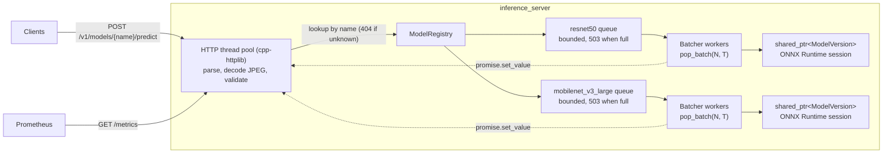
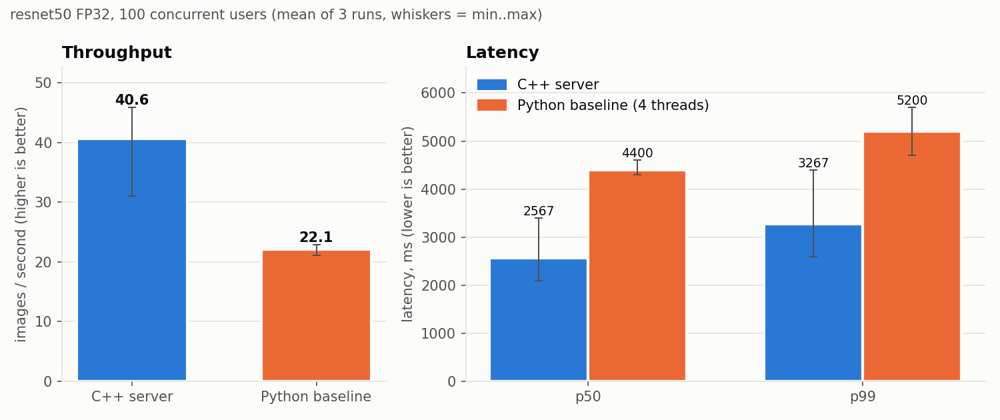
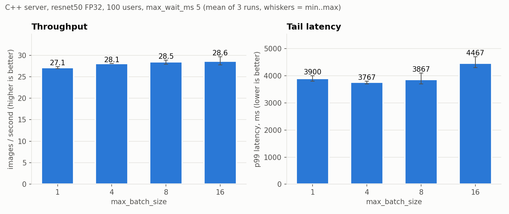

# Mini Triton: a C++ ML inference server

[](https://github.com/Shreyeshshinde/ml-inference-server/actions/workflows/ci.yml)

A C++17 server that keeps ONNX image classifiers loaded in memory and serves them over HTTP, with dynamic batching, a separate queue and worker pool per model, backpressure (503), timeouts (504), zero-downtime model reload and Prometheus metrics. Small enough to understand every line; similar in spirit to NVIDIA Triton or TorchServe.

## Headline results

All numbers were measured on one laptop (Intel i7-1360P, 16 logical CPUs, 8 GB RAM for WSL2). See [Benchmarks](#benchmarks) for the method and the raw CSVs.

| | Result |
|---|---|
| Throughput vs Python | **1.5x to 2.0x** the throughput of a FastAPI + PyTorch baseline on the same CPUs (ResNet-50, 100 concurrent users; 29.8 vs 17.6 images/s mean in the official run) |
| Latency vs Python | p50 **3.3 s vs 5.5 s**, p99 **4.0 s vs 6.3 s** at 100 concurrent users (mostly queueing time, see below) |
| Zero-downtime reload | **0 failed requests** out of 882 while ResNet-50 was reloaded twice under live traffic on both models |
| Overload | **0 crashes, 0 500s** at 200 concurrent users; excess load gets a fast 503 (p50 about 35 ms) |
| INT8 ResNet-50 | **3.9x smaller** (102.2 to 26.1 MB), **1.3x faster** single-image inference, top-1 down only **0.13 points** (86.83% to 86.70%) |

## Architecture



How one request flows:

1. An HTTP thread receives the upload, checks the model name (404), rejects early with 503 if that model's queue is already full, then decodes the image (400 if it is not an image).
2. It pushes `{image, top_k, deadline, promise}` into the model's bounded queue and waits on the matching `std::future` until its deadline (504 on timeout).
3. A batcher worker calls `pop_batch(max_batch_size, max_wait_ms)`: it waits for one request, then keeps collecting until the batch is full or `max_wait_ms` has passed since the first request arrived.
4. The worker preprocesses every image straight into one `[N, 3, 224, 224]` buffer, runs the model once, splits the `[N, 1000]` output, applies softmax and top-k, and fulfills each promise. If anything throws, every promise in the batch gets the exception, so no client hangs.
5. Workers skip requests whose deadline has already passed instead of computing answers nobody is waiting for.

## Quick start

### Docker (any machine)

```bash
docker build -t mini-triton .          # exports the models with PyTorch during the build
docker run --rm -p 8080:8080 mini-triton

curl -F "image=@dog.jpg" "http://localhost:8080/v1/models/resnet50/predict?top_k=3"
```

- **Models:** the image contains both FP32 models, exported from torchvision's public pretrained weights during the build and never committed to Git.
- **Build:** three stages (PyTorch export, C++ build, slim runtime). The build took 8 minutes on the benchmark laptop with some layers cached; a fully fresh build downloads PyTorch and takes longer.
- **Image size:** 676 MB, mostly 124 MB of models, 213 MB of Ubuntu's OpenCV runtime libraries and an 88 MB Ubuntu base.
- **Security:** the server runs as an unprivileged user, and the image has a `HEALTHCHECK`.
- **Prometheus:** `docker compose up --build` also starts Prometheus at http://localhost:9090, scraping `/metrics` every 5 s.

### From source (Ubuntu 22.04 or WSL2)

```bash
sudo bash scripts/setup_deps.sh                        # compiler, CMake, OpenCV, ONNX Runtime 1.17.3
cmake -S . -B build -DCMAKE_BUILD_TYPE=Release && cmake --build build -j
ctest --test-dir build --output-on-failure             # 56 unit tests

python3 -m venv ~/venvs/mis && source ~/venvs/mis/bin/activate
pip install -r python/requirements.txt --extra-index-url https://download.pytorch.org/whl/cpu
python python/export_onnx.py                           # models/*.onnx + data/imagenet_labels.txt
./build/inference_server --config config/server.json
```

Optional: `bash scripts/download_data.sh` (Imagenette, about 340 MB) for the accuracy, quantization and benchmark scripts.

## API

| Method and path | Description |
|---|---|
| `POST /v1/models/{name}/predict` | Multipart upload with field `image`; optional `?top_k=5` (1 to 1000) |
| `GET /v1/models` | Loaded models with version, status (`ready` or `reloading`), file path and all settings |
| `POST /v1/models/{name}/reload` | Load a new version with zero downtime. Optional JSON body `{"path": "models/x.onnx", "version": 2}`; defaults to the same file and version + 1 |
| `GET /health` | `{"status":"ok"}` |
| `GET /metrics` | Prometheus text format, every series labeled `model="..."` |

Example prediction response:

```json
{
  "model": "resnet50",
  "version": 1,
  "predictions": [
    {"class_id": 217, "label": "English springer", "score": 0.5201},
    {"class_id": 219, "label": "cocker spaniel", "score": 0.0245}
  ],
  "batch_size": 8,
  "latency_ms": 41.7,
  "timings_ms": {"queue_wait": 3.1, "preprocess": 4.9, "inference": 32.6, "postprocess": 0.1}
}
```

`version` is the version that actually computed this answer, and `batch_size` is how many requests shared that model run.

| Status | When |
|---|---|
| 400 | Missing `image` field, not a decodable image, bad `top_k`, bad reload body or path |
| 404 | Unknown model name |
| 409 | A reload of this model is already running |
| 413 | Body larger than `max_body_mb` |
| 500 | The model run failed |
| 503 | The model's queue is full (with `Retry-After: 1`) |
| 504 | No result before `request_timeout_ms` |

Metrics include request, error, 503, 504 and batch counters, average batch size, queue length, serving version, p50/p99 latency over the last 2048 requests, and a `mis_request_latency_seconds` histogram.

### Configuration

Everything model-specific lives in `config/server.json`, so serving another ONNX image classifier is a config change:

```json
{
  "name": "resnet50", "path": "models/resnet50.onnx", "version": 1,
  "resize_short": 256, "input_size": 224,
  "mean": [0.485, 0.456, 0.406], "std": [0.229, 0.224, 0.225],
  "max_batch_size": 8, "max_wait_ms": 5, "num_workers": 2, "intra_op_threads": 4,
  "queue_limit": 256, "request_timeout_ms": 5000
}
```

`config/server_int8.json` serves the INT8 models instead. The server warns at startup if the sum of `num_workers x intra_op_threads` over all models exceeds the CPU core count.

## Benchmarks

### Method

- **Load generator:** Locust, closed loop: every simulated user sends the next upload as soon as the previous answer arrives. The same 50 Imagenette validation images are used for every run and both servers.
- **Isolation:** the server is pinned to logical CPUs 0 to 11 and Locust to CPUs 12 to 15 (`taskset`).
- **Each run:** 50 warm-up requests, then 60 seconds of load. Every configuration is run 3 times, with 20 seconds of idle cooldown between runs and alternating run order.
- **Throughput:** successful responses the client received, divided by the run length.
- **Fairness:**
  - The Python baseline uses the same OpenCV preprocessing and JSON format.
  - It loads the model once and runs under `torch.inference_mode()`.
  - It was tuned first: 4, 8 and 12 PyTorch threads gave 23.7, 21.1 and 19.6 images/s, so it runs with its best setting, 4.
  - Both servers run ResNet-50 FP32, and the C++ server logs nothing per request, like the baseline.
- **Raw data:** `results/bench_*.csv` (one row per run) and `results/bench_hardware.txt`. To reproduce, run `bash bench/run_all.sh` (about 50 minutes).

**Caveat about this machine:** the laptop ran in two distinct speed states, about 44 images/s or about 28 images/s for the same C++ configuration. Runs within one experiment are comparable; absolute numbers across experiments are not. Most likely Windows schedules the WSL2 VM onto efficiency cores at times; I could not verify the cause from inside WSL.

### 1. C++ server vs Python baseline (ResNet-50, 100 users)



| Run | C++ images/s | Python images/s | Ratio |
|---|---|---|---|
| 1 | 32.4 | 17.5 | 1.85x |
| 2 | 28.3 | 17.4 | 1.63x |
| 3 | 28.7 | 17.8 | 1.61x |

An earlier session gave 2.02x, 1.47x and 2.00x, so the range across both sessions is 1.5x to 2.0x. Neither server failed a request in these runs.

Why the latency is in seconds: with 100 closed-loop users, latency is roughly `users / throughput` (Little's law), so 100 / 29.8 is about 3.4 s. Nearly all of that is time waiting in the queue; a single ResNet-50 inference takes about 45 ms. Lower latency at this load needs more compute, not a faster queue.

### 2. Batch size sweep (C++, ResNet-50, 100 users, `max_wait_ms` 5)



| max_batch_size | 1 | 4 | 8 | 16 |
|---|---|---|---|---|
| Images/s (mean of 3) | 27.3 | 26.7 | 28.8 | 28.8 |
| p99 latency (ms) | 3933 | 4133 | 4000 | 4267 |

On this CPU, batching adds only about 5% throughput (1 to 8), and batch 16 costs extra tail latency. ONNX Runtime already spreads a single image across `intra_op_threads` cores, so the CPU is busy even at batch size 1. Batching pays off much more on GPUs, where one image leaves most of the device idle. One batch-4 run included 63 timeouts (504), which pulls its mean down; the other two batch-4 runs were clean. An earlier session showed the same pattern (27.1, 28.1, 28.5, 28.6 images/s).

### 3. Load levels (C++, ResNet-50, `queue_limit` 64)

| Users | 10 | 50 | 100 | 200 |
|---|---|---|---|---|
| Images/s (mean of 3) | 40.0 | 43.3 | 40.5 | 35.2 |
| p50 latency of successful requests | 240 ms | 1.1 to 1.2 s | mixed with 503s | mixed with 503s |
| 503 responses per 60 s run | 0 | 0 | about 40,600 | about 115,000 to 123,000 |
| 500 errors | 0 | 0 | 0 | 0 |

- **Saturation:** throughput is already close to its maximum at 10 users. More users only add queueing time.
- **Where 503s start:** between 50 and 100 users. With 64 queue slots plus a batch in flight, 100 users can no longer all fit.
- **The server stays up under overload:** at 200 users it keeps serving about 35 images/s and answers the excess with fast 503s (p50 about 35 ms).
- **What overload still costs:** about 20% throughput compared with 50 users, because every rejected request still uploads and parses its roughly 100 KB body.

### INT8 quantization (Imagenette validation, 3,925 images)

| Model | Precision | Size | Single-image latency (p50) | Top-1 | Top-5 |
|---|---|---|---|---|---|
| ResNet-50 | FP32 | 102.2 MB | 44.3 ms | 86.83% | 98.68% |
| ResNet-50 | INT8 | 26.1 MB | 33.1 ms | 86.70% | 98.55% |
| MobileNetV3-Large | FP32 | 21.9 MB | 3.5 ms | 80.82% | 96.82% |
| MobileNetV3-Large | INT8 | 6.0 MB | 7.5 ms | 78.11% | 94.93% |

How these were produced:
- **Quantization:** static INT8, QDQ format, per-channel weights, calibrated on 200 Imagenette **train** images, so the validation images stay unseen.
- **Accuracy:** top-1 and top-5 over all 1,000 ImageNet classes.
- **Latency:** ONNX Runtime only, with 4 threads. ResNet-50's INT8 speedup ranged from 1.34x to 1.81x over three eval runs; 1.3x is the typical value.

**MobileNetV3 needed a different recipe** (`results/mobilenet_int8_experiments.csv`):
- **First attempt:** the default (MinMax calibration, all ops quantized) lost 13 points of top-1 *and* ran 3.7x slower than FP32. Its HardSwish and squeeze-excite `Mul` ops have no fast INT8 kernels, so the graph filled up with quantize/dequantize steps.
- **Speed fix:** quantizing only Conv and Gemm fixed the speed.
- **Accuracy fix:** Percentile calibration, which ignores the extreme 0.01% of activations, cut the accuracy loss to 2.7 points.
- **Still slower than FP32:** even so, INT8 MobileNet is slower than FP32 on this CPU. It's already tiny, so INT8 mainly buys a 3.7x smaller file.

## Design decisions and tradeoffs

**Why C++.** The point of the project is to control the serving path: threads, queues, memory layout and copies. Both servers hand the heavy math to optimized native kernels (ONNX Runtime here, PyTorch in the baseline), so the difference comes from everything around the model call: no GIL, preprocessing written straight into the batch buffer, batching, and a few cheap pointer copies per request.

**Why dynamic batching, and the knobs.** A model run has fixed per-call overhead, and batching shares it. `max_batch_size` caps how much work shares one run; `max_wait_ms` caps how long the first request in a batch may wait for company. Under heavy load batches fill instantly; under light load a lone request waits at most `max_wait_ms`. The deadline is measured from when the first request was *enqueued*, so a request never waits longer than `max_wait_ms` for a batch to fill. Measured here, the gain is small on CPU (about 5%), which is itself a useful result: batching is a GPU-first optimization.

**Why one queue and worker pool per model.** Isolation: a flood of ResNet-50 traffic fills only ResNet-50's queue and gets 503s, while MobileNet keeps serving. Each model also gets its own batch settings and thread budget.

**How the queue works.** A `std::deque` guarded by a mutex, plus a condition variable so workers sleep instead of spinning. `push()` returns false when the queue is full or closed: that is the backpressure point. `pop_batch()` waits in two phases (any item, then batch full or first-item deadline), re-checking its condition on every wakeup so spurious wakeups are harmless. A stress test pushes 20,000 items through 4 producers and 3 consumers and checks that every item comes out exactly once.

**How results get back.** Each request carries a `std::promise`; the HTTP thread keeps the `std::future`. Workers fulfill promises only after the whole batch succeeds, so on any exception they can safely call `set_exception` on every promise in the batch.

**Zero-downtime reload.** Each batcher holds a `std::shared_ptr<const ModelVersion>` (version, path, ONNX session), read with `std::atomic_load` and replaced with `std::atomic_exchange`. Reload first loads and warms up the new file while the old one keeps serving, then swaps the pointer in one atomic step. Each worker takes its own copy of the pointer once per batch, so an in-flight batch always finishes on the version it started with, and the old version is freed automatically when the last copy is dropped. Only one reload per model may run at a time (409), the path must stay inside `models/`, and a file that fails to load or warm up never replaces the working version.

**Backpressure and failure handling.**
- **503:** a full queue is rejected *before* the JPEG is decoded. The first benchmark found that decoding rejected images starved the inference workers: 110 images in 60 s at 100 users.
- **504:** a request that waits past its deadline gets 504, and workers skip already-expired requests instead of computing them.
- **Bad input:** a fuzz test sends 100 random and truncated payloads and checks that the server stays healthy.
- **Graceful shutdown:** on SIGINT/SIGTERM, a dedicated `sigwait` thread stops the HTTP server first, so in-flight requests finish while the workers still run, then drains every model's queue and joins the workers.

**Why INT8.** Smaller files and faster integer math on CPUs with VNNI. The cost is accuracy, which must be measured per model: here it was negligible for ResNet-50 and needed a custom recipe for MobileNetV3.

**Scaling beyond one machine.** The server keeps no per-user state, so it scales horizontally:
- put N copies behind a load balancer;
- route on `/health`;
- treat 503 as "try another replica".

Queue length and p99 from `/metrics` are the natural autoscaling signals, because they rise before latency becomes visible to users.

## Testing and quality

- **56 GoogleTest tests** cover preprocessing, postprocessing, the model runner, config parsing, the queue, the batcher, the registry and reload, metrics, and end-to-end HTTP (404, 400, 413, 503 and 504 paths, fuzzing, two models served together, and reload under continuous traffic). Tests that need model files skip themselves when the models are absent, as in CI.
- **CI:** GitHub Actions runs the build with `-Werror`, the full test suite under AddressSanitizer, and a `clang-format` check on every push.
- **Correctness checks:**
  - **ONNX export:** PyTorch vs ONNX Runtime agree within 1.4e-5 on 20 images.
  - **C++ vs Python:** top-5 match on 20 of 20 images, for all four model files.

## Limitations

- **One thread per connection.** cpp-httplib holds a thread for each open keep-alive connection, so concurrency is capped by `http_threads`; an event-loop server (epoll) would not need a thread per connection.
- **Overload still costs CPU.** Rejected requests still upload and parse their full body before the 503.
- **CPU only.**
- **Image classification only:** one input tensor `[N, 3, H, W]` and one output `[N, classes]`.
- **Laptop-only benchmarks:** absolute numbers depend on that machine's speed state (see the caveat above).
- **ResNet-50 bias quantization warning:** quantizing ResNet-50 prints a NumPy "invalid value encountered in cast" warning, most likely from a weight channel with zero scale. The measured accuracy cost is 0.13 points.
- **No authentication:** the reload endpoint is open to anyone who can reach the port, apart from the path restriction.

## Future work

- **gRPC endpoint:** binary protobuf instead of multipart, plus streaming.
- **GPU execution provider:** CUDA or TensorRT, where dynamic batching should matter much more.
- **Reject before reading the body:** using a content receiver, to make overload nearly free.
- **Autoscaling:** on queue length and p99, behind a load balancer.
- **Adaptive batching:** choose `max_wait_ms` from the current arrival rate.
- **Authentication:** for the admin endpoints (`/reload`).

## Project layout

```
include/, src/     server, registry, batcher, queue, model runner, pre/postprocess, config, metrics
tests/             GoogleTest suites
tools/classify.cpp command-line classifier used for C++ vs Python checks
python/            export, verify, quantize, accuracy eval, FastAPI baseline
bench/             Locust file, benchmark driver, charts
config/            server.json (FP32), server_int8.json
results/           CSVs and charts from the measurements above
scripts/           dependency setup, dataset download, demos (batching, reload, smoke test)
```
